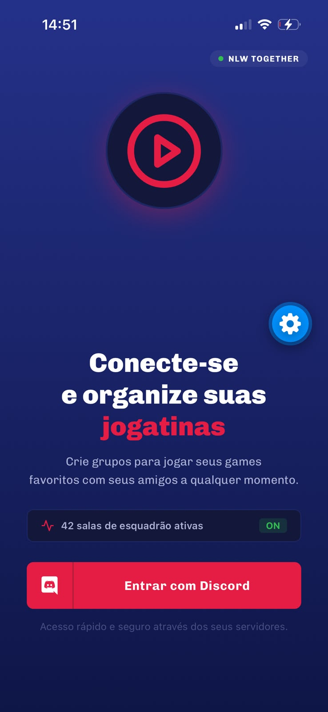
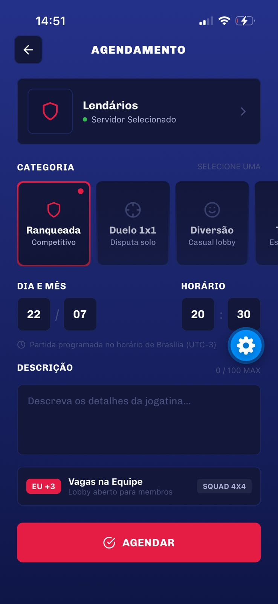
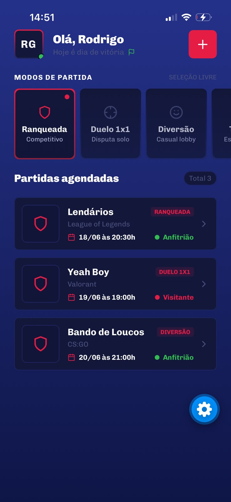
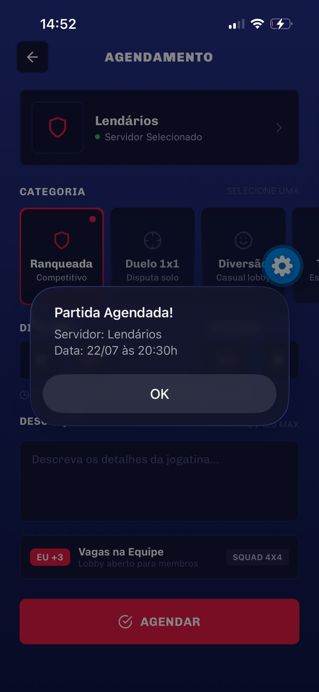

# 🎮 GamePlay — Aplicativo Mobile

**Uma interface para quem gosta de jogar online e organizar partidas com amigos.**

O GamePlay é um projeto acadêmico desenvolvido com **React Native, Expo e TypeScript**. A proposta é criar uma experiência mobile com telas para visualizar servidores de jogos, consultar informações e organizar agendamentos de partidas.

O projeto foi uma oportunidade de praticar o desenvolvimento de interfaces para celular, a navegação entre telas e a organização de um aplicativo usando tecnologias do ecossistema React Native.

## 📱 Conheça o aplicativo

As imagens abaixo mostram as telas desenvolvidas para o GamePlay.

### 🔐 Login

Tela inicial do aplicativo, que apresenta a entrada para a experiência do GamePlay.



### 🏠 Home

Área principal do aplicativo, com a visualização dos servidores de jogos disponíveis no protótipo.


### 🎯 Detalhes do servidor

Tela dedicada às informações do servidor selecionado, permitindo consultar seus detalhes antes de organizar uma partida.



### 📅 Agendamento de partida

Interface para organizar uma partida e selecionar a categoria desejada.



### ✅ Confirmação

Tela que apresenta a confirmação do agendamento realizado no protótipo.



## ✨ O que desenvolvi neste projeto

- Interfaces mobile para diferentes etapas da experiência do usuário.
- Navegação entre as telas do aplicativo.
- Visualização de servidores e seus detalhes.
- Tela de agendamento com seleção de categoria.
- Organização do código em componentes e telas.

## 🛠️ Tecnologias utilizadas

| Tecnologia | Utilização |
|---|---|
| React Native | Desenvolvimento das interfaces mobile |
| Expo | Execução e testes do aplicativo |
| TypeScript | Escrita do código com tipagem |
| React Navigation | Navegação entre as telas |

## 🚀 Como executar o projeto

Você pode executar o GamePlay no seu computador e testar as telas em um celular compatível.

**Pré-requisitos**
- Node.js instalado.
- Projeto baixado no computador.
- Expo Go instalado no celular, caso queira testar por ele.

**1. Baixe o projeto**

Na página do repositório, clique em **Code → Download ZIP** e extraia o arquivo. Você também pode clonar o repositório com Git.

**2. Abra a pasta do projeto**

Abra a pasta no VS Code e inicie um terminal.

**3. Instale as dependências**

```bash
npm install
```

**4. Inicie o Expo**

```bash
npx expo start
```

**5. Teste no celular**

Abra o Expo Go e siga as instruções apresentadas pelo Expo para conectar ao projeto.

## 📌 Sobre o desenvolvimento

Este projeto foi desenvolvido para fins acadêmicos, com dados demonstrativos. Ele não possui backend, banco de dados ou autenticação real com o Discord.

## 👨‍💻 Autor

**Kauã Kairon Alves de Melo**

Estudante de Análise e Desenvolvimento de Sistemas.

Projeto desenvolvido como parte da minha prática em desenvolvimento mobile.
